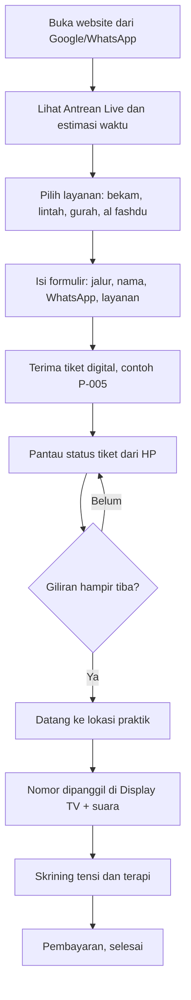
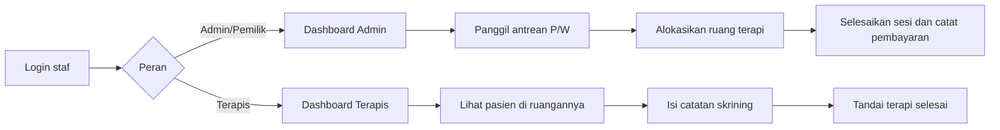
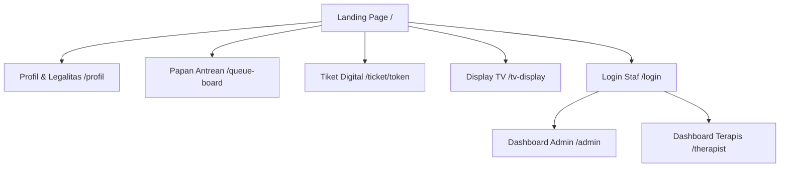

# Laporan Perancangan UI/UX
# Bekam Smart Queue — Sistem Antrean Digital untuk Bekam Bintan Therapy

**Objek/UMKM:** Bekam Bintan Therapy — praktik pengobatan tradisional (Thibbun Nabawi) di Kabupaten Bintan, Kepulauan Riau
**Produk:** Website antrean online, papan antrean publik, display TV ruang tunggu, dan dashboard staf
**Platform:** Web responsif (mobile-first untuk pasien, desktop/TV untuk klinik)
**Sumber data objek:** Website resmi [bekambintan.blogspot.com](https://bekambintan.blogspot.com/) (halaman Tentang Kami, Terapi Bekam Steril, Terapi Lintah, Gurah Hidung, Al Fashdu, Profil Terapis, Legalitas, Alamat), diakses 21 Oktober 2026

> **Catatan untuk penyusun:**
> - Data profil UMKM (layanan, legalitas, kondisi website) diambil dari website resmi Bekam Bintan Therapy.
> - Alamat dan nomor WhatsApp diambil dari hasil pencarian web (halaman Facebook), bukan dari blog, jadi **konfirmasi ulang ke pemilik**.
> - Angka responden, kutipan, dan persentase di Bagian 2 masih **draf contoh**. Ganti dengan data asli dari wawancara/kuesioner Anda. Bagian yang wajib diganti ditandai **[ISI DATA ASLI]**.

---

## Daftar Isi

1. [Identifikasi Masalah](#1-identifikasi-masalah)
2. [Riset Pengguna](#2-riset-pengguna)
3. [User Persona](#3-user-persona)
4. [User Problem & User Needs](#4-user-problem--user-needs)
5. [Ide/Konsep Solusi](#5-idekonsep-solusi)
6. [Fitur](#6-fitur)
7. [Desain UI — Layout](#7-desain-ui--layout)
8. [Desain UI — Warna](#8-desain-ui--warna)
9. [Desain UI — Tipografi](#9-desain-ui--tipografi)
10. [Desain UI — Keselarasan/Konsistensi](#10-desain-ui--keselarasankonsistensi)
11. [Desain UI — Usability](#11-desain-ui--usability)
12. [Kesimpulan](#12-kesimpulan)

---

# BAGIAN A — RISET

## 1. Identifikasi Masalah

### 1.1 Profil Objek

| Aspek | Keterangan |
|---|---|
| **Nama usaha** | Bekam Bintan Therapy |
| **Bidang** | Pengobatan tradisional Islami (Thibbun Nabawi) |
| **Wilayah layanan** | Tanjung Uban, Seri Kuala Lobam, dan sekitarnya, Kabupaten Bintan, Kepulauan Riau |
| **Alamat** | Jl. Indunsuri No. 116C, Taman Kota, Desa Teluk Sasah, Kec. Seri Kuala Lobam, Kab. Bintan *(dari halaman Facebook, perlu konfirmasi)* |
| **Kontak** | WhatsApp +62 812-6832-0072 *(dari halaman Facebook, perlu konfirmasi)* |
| **Legalitas** | Terdaftar di Dinas Kesehatan Kabupaten Bintan — **STPT No. 001/Yankes/Batra/VII/2013** |
| **Keanggotaan profesi** | Anggota **Ikatan Terapis Bekam Indonesia (ITBI)** — Nomor 000341.00014.0003293 |
| **Kompetensi terapis** | Memiliki berbagai sertifikat pendidikan dan pelatihan pengobatan alami (ditampilkan di halaman Profil Terapis) |
| **Slogan** | *"Biaya terapi pengobatan kami murah, mujarab, halal, dan insya Allah barokah."* |
| **Jam operasional** | **[ISI DATA ASLI]** — tidak dicantumkan di website |

**Layanan yang ditawarkan:**

| No | Layanan | Keterangan (dari website) |
|---|---|---|
| 1 | **Terapi Bekam Steril** | Bekam (hijamah) pada titik-titik bekam Nabi, meridian, akupresur, dan refleksi. Berfungsi promotif, preventif, paliatif, dan kuratif |
| 2 | **Terapi Al Fashdu** | Pengeluaran darah melalui pembuluh vena (metode pengobatan Nabawi) |
| 3 | **Terapi Lintah** | Terapi dengan lintah *Hirudo medicinalis* untuk melancarkan peredaran darah |
| 4 | **Terapi Gurah Hidung** | Terapi tetes herbal untuk membersihkan lendir di saluran hidung/pernapasan |
| 5 | **Home Care** | Terapis datang ke rumah pasien dengan perjanjian terlebih dahulu *(dari halaman Facebook)* |

### 1.2 Kondisi Saat Ini

| Aspek | Cara Kerja Saat Ini |
|---|---|
| Informasi online | Blog Blogger yang terakhir diperbarui tahun 2017 (sebagian besar artikel dari 2013) |
| Pendaftaran | Pasien datang langsung atau menghubungi WhatsApp terapis |
| Nomor antrean | Tidak ada sistem nomor; urutan diatur manual **[ISI DATA ASLI — konfirmasi ke pemilik]** |
| Info waktu tunggu | Tidak ada; pasien harus bertanya via chat/telepon |
| Info harga | Tidak dicantumkan di website, hanya klaim "biaya murah" |
| Jadwal home care | Diatur manual lewat chat |
| Catatan pasien | Manual / tidak terdokumentasi digital **[ISI DATA ASLI — konfirmasi ke pemilik]** |

### 1.3 Analisis Website yang Ada Sekarang

Hasil pengamatan langsung pada [bekambintan.blogspot.com](https://bekambintan.blogspot.com/):

| No | Temuan | Dampak bagi Pengguna |
|---|---|---|
| 1 | Memakai template Blogger "AzSands" (2013) dengan **lebar tetap 1011px** | Tidak responsif; di HP tulisan kecil dan harus digeser ke samping |
| 2 | **Artikel terbaru dari November 2017**, sebagian besar dari 2013 | Pengunjung ragu apakah praktik masih buka |
| 3 | **Tidak ada informasi harga** dan **jam operasional** | Pasien harus bertanya dulu sebelum memutuskan datang |
| 4 | Halaman **Alamat, Gurah Hidung, dan Al Fashdu hampir tidak berisi teks** (hanya gambar/kosong) | Informasi penting tidak bisa dibaca, dicari, atau disalin |
| 5 | **Tidak ada fitur pendaftaran atau antrean online** | Semua pendaftaran menumpuk di WhatsApp terapis |
| 6 | Menu utama berisi 9 item, ditambah 5+ daftar artikel di sidebar yang isinya berulang | Navigasi padat; informasi inti (layanan, alamat, kontak) tenggelam |
| 7 | Sisa placeholder template belum diganti, misalnya tautan Twitter `YOUR_USERNAME` dan favicon `YOUR-FAVICON-URL` | Terlihat tidak terawat dan kurang profesional |
| 8 | Banyak artikel berisi klaim kesembuhan penyakit berat tanpa sumber rujukan | Berisiko menurunkan kepercayaan calon pasien yang kritis |
| 9 | Semua artikel memiliki **0 komentar** | Tidak ada interaksi; tidak ada testimoni yang bisa diverifikasi |

**Kekuatan yang perlu dipertahankan:**
- Ada halaman **Legalitas** (STPT Dinkes & keanggotaan ITBI), yang penting untuk kepercayaan.
- Ada halaman **Profil Terapis** dengan bukti sertifikat pelatihan.
- Layanannya **beragam** (bekam, al fashdu, lintah, gurah, home care).

### 1.4 Masalah Utama

1. **Kehadiran digital sudah usang.** Website tidak diperbarui sejak 2017, tidak responsif di HP, dan tidak memuat informasi dasar (harga, jam buka, alamat dalam bentuk teks).
2. **Tidak ada sistem antrean.** Pasien tidak tahu harus datang jam berapa dan berapa lama menunggu.
3. **Pendaftaran bergantung pada WhatsApp terapis.** Terapis harus membalas chat sambil menangani pasien, sehingga balasan lambat dan urutan rawan tertukar.
4. **Layanan pria dan wanita perlu diatur terpisah.** Bekam melayani pria dan wanita, dan dalam praktik Thibbun Nabawi pasien idealnya ditangani terapis sesama jenis, tetapi tidak ada sistem yang memisahkan antreannya.
5. **Jadwal home care dan kunjungan di tempat bercampur.** Saat terapis pergi home care, pasien yang datang langsung tidak tahu dan bisa menunggu sia-sia.
6. **Kepercayaan belum dibangun dengan baik secara online.** Legalitas dan sertifikat sebenarnya ada, tetapi tertutup oleh tampilan blog yang usang dan artikel berklaim berlebihan.

### 1.5 Dampak Masalah

- Calon pasien baru (terutama yang mencari lewat Google) ragu dan memilih tempat lain.
- Pasien menunggu lama atau datang saat terapis sedang home care.
- Terapis kelelahan mengurus chat, jadwal, dan terapi sekaligus.
- Potensi pendapatan hilang karena slot kosong di jam sepi tidak terisi.

---

## 2. Riset Pengguna

### 2.1 Tujuan Riset

1. Memahami pengalaman pasien saat mencari info dan mendaftar terapi di Bekam Bintan Therapy.
2. Menemukan kendala terbesar mulai dari mencari informasi sampai selesai terapi.
3. Mengetahui kebiasaan penggunaan smartphone pasien di wilayah Bintan.
4. Memahami kebutuhan terapis/pemilik dalam mengelola antrean dan jadwal home care.

### 2.2 Metode Riset

| Metode | Responden/Objek | Cara Pelaksanaan | Tujuan |
|---|---|---|---|
| **Analisis website eksisting** | [bekambintan.blogspot.com](https://bekambintan.blogspot.com/) | Menelusuri semua halaman menu dan mencatat masalah (lihat 1.3) | Mengetahui kelemahan dan kekuatan kehadiran digital saat ini |
| **Wawancara mendalam** | Pemilik/terapis + 5 pasien **[ISI DATA ASLI]** | Tatap muka atau telepon, ±15–20 menit, pertanyaan semi-terstruktur | Menggali pengalaman, kendala, dan harapan |
| **Kuesioner online** | 30 responden warga Bintan/Tanjung Uban **[ISI DATA ASLI]** | Google Form disebar lewat grup WhatsApp warga/pengajian | Mengukur seberapa umum masalah yang ditemukan |
| **Observasi lapangan** | Lokasi praktik | Mengamati proses kedatangan, menunggu, dan terapi **[ISI DATA ASLI]** | Melihat perilaku nyata pasien dan terapis |
| **Studi kompetitor** | Antrean online rumah sakit, aplikasi booking barbershop, dan website klinik bekam lain | Mencoba alur pendaftaran | Mencari pola desain yang sudah familiar |

### 2.3 Daftar Pertanyaan Wawancara

**Untuk pasien:**
1. Dari mana Anda pertama kali tahu tentang Bekam Bintan Therapy?
2. Pernahkah Anda membuka website/blognya? Apa kesan Anda?
3. Bagaimana cara Anda mendaftar atau membuat janji terapi?
4. Berapa lama biasanya Anda menunggu sebelum diterapi?
5. Pernahkah Anda datang tetapi terapis sedang tidak ada (misalnya sedang home care)?
6. Informasi apa yang paling ingin Anda ketahui sebelum datang?
7. Apakah Anda bersedia mendaftar lewat HP? Apa syaratnya supaya Anda mau?

**Untuk pemilik/terapis:**
1. Berapa rata-rata pasien per hari, dan kapan jam paling ramai?
2. Berapa terapis pria dan wanita yang bertugas?
3. Bagaimana cara Anda mengatur antrean dan jadwal home care saat ini?
4. Berapa lama durasi rata-rata setiap jenis terapi (bekam, lintah, gurah, al fashdu)?
5. Kendala apa yang paling menyita waktu Anda di luar proses terapi?

### 2.4 Hasil Kuesioner **[ISI DATA ASLI]**

| Pertanyaan | Hasil (contoh) |
|---|---|
| Mencari info pengobatan/klinik lewat Google atau media sosial | 80% |
| Pernah membuka website klinik bekam lewat HP dan sulit dibaca | 63% |
| Ingin melihat harga sebelum datang | 87% |
| Tidak tahu perkiraan waktu tunggu saat datang | 77% |
| Lebih suka daftar online daripada chat lalu menunggu balasan | 73% |
| Tidak mau membuat akun/password hanya untuk antre | 80% |
| Lebih nyaman jika ditangani terapis sesama jenis | 90% (97% pada responden wanita) |
| Usia 30 tahun ke atas | 60% |

### 2.5 Temuan Kunci (Insight)

1. **Kesan pertama terbentuk dari HP.** Calon pasien mencari lewat Google di HP; blog yang tidak responsif dan usang langsung menurunkan kepercayaan.
2. **Harga dan jam buka adalah informasi wajib.** Tanpa info ini pasien harus chat dulu, dan banyak yang batal di tahap ini.
3. **Ketidakpastian lebih menyebalkan daripada lamanya menunggu.** Pasien bisa menerima antrean panjang asal tahu perkiraannya.
4. **Pemisahan pria/wanita adalah kebutuhan utama**, bukan fitur tambahan.
5. **Terapis butuh lepas dari chat yang berulang.** Pertanyaan "hari ini buka?", "antre berapa?", dan "berapa harganya?" bisa dijawab oleh sistem.
6. **Legalitas meningkatkan kepercayaan.** STPT Dinkes dan keanggotaan ITBI perlu ditampilkan jelas, bukan disembunyikan di menu ke-8.

### 2.6 Kutipan Responden **[ISI DATA ASLI]**

> "Saya kerja shift di Lobam, liburnya tidak tentu. Kalau bisa lihat antrean dari HP, saya tinggal datang." — Pasien pria, 38 tahun

> "Saya cari di Google ketemu blognya, tapi tidak ada harga dan jam bukanya, jadi harus chat dulu." — Pasien wanita, 31 tahun

> "Kadang saya sedang home care, lalu ada pasien datang ke tempat dan menunggu. Kasihan." — Terapis/pemilik

### 2.7 Hasil Studi Kompetitor

| Produk | Kelebihan yang Diadopsi | Kekurangan yang Dihindari |
|---|---|---|
| Antrean online rumah sakit | Nomor antrean + estimasi waktu | Wajib akun & data lengkap, alur panjang |
| Antrean bank (mesin tiket + TV) | Display TV + panggilan suara | Hanya bisa ambil nomor di lokasi |
| Booking barbershop | Pilih layanan + harga jelas | Tidak ada status antrean real-time |
| Blog Bekam Bintan Therapy (eksisting) | Halaman legalitas & profil terapis | Tidak responsif, tanpa harga/jam/booking |

---

## 3. User Persona

### Persona 1 — Pasien Pria Pekerja Shift

| | |
|---|---|
| **Nama** | Pak Ahmad Rizki |
| **Usia** | 38 tahun |
| **Pekerjaan** | Operator pabrik di Kawasan Industri Lobam (kerja shift) |
| **Domisili** | Tanjung Uban, ±10 km dari lokasi praktik |
| **Kemampuan teknologi** | Sedang — aktif WhatsApp, YouTube, dan Facebook |
| **Layanan yang dipakai** | Bekam steril rutin sebulan sekali |

**Bio:** Pak Ahmad berbekam untuk mengurangi pegal dan kelelahan akibat kerja shift. Hari liburnya berganti-ganti, jadi ia sering memutuskan berbekam secara mendadak.

**Kebiasaan:**
- Mencari info lewat Google atau Facebook dari HP.
- Lebih suka info singkat: buka atau tidak, antre berapa, harganya berapa.
- Malas menunggu balasan chat yang lama.

**Tujuan:**
- Tahu apakah terapis pria sedang tersedia hari ini.
- Datang tepat saat gilirannya dekat agar waktu istirahat tidak terbuang.

**Kendala (Pain Points):**
- Website lama tidak memuat jam buka dan harga.
- Chat WhatsApp kadang lama dibalas karena terapis sedang menangani pasien.
- Pernah datang saat terapis sedang home care.

> *"Saya cuma mau tahu: hari ini buka, antre berapa, harganya berapa."*

---

### Persona 2 — Pasien Wanita Ibu Rumah Tangga

| | |
|---|---|
| **Nama** | Ibu Siti Aisyah |
| **Usia** | 33 tahun |
| **Pekerjaan** | Ibu rumah tangga, 2 anak |
| **Domisili** | Seri Kuala Lobam, ±3 km dari lokasi praktik |
| **Kemampuan teknologi** | Sedang — aktif WhatsApp dan Instagram, jarang memakai aplikasi baru |
| **Layanan yang diminati** | Bekam steril dan gurah hidung (untuk anak yang sering pilek) |

**Bio:** Ibu Siti harus mengatur waktu di sela antar-jemput anak sekolah. Ia hanya mau ditangani terapis wanita dan sangat memperhatikan kebersihan alat.

**Kebiasaan:**
- Hanya punya waktu luang sekitar 09.00–11.00.
- Enggan mengunduh aplikasi atau membuat akun.
- Membaca legalitas dan ulasan sebelum mencoba tempat baru.

**Tujuan:**
- Dilayani terapis wanita.
- Yakin alatnya steril dan praktiknya resmi.
- Bisa memilih home care jika sedang tidak bisa keluar rumah.

**Kendala (Pain Points):**
- Tidak tahu kapan terapis wanita tersedia.
- Website sulit dibaca di HP, info gurah hidung tidak berisi penjelasan.
- Tidak mau ribet registrasi akun dan mengingat password.

> *"Yang penting terapisnya perempuan, alatnya steril, dan saya tidak menunggu lama sambil bawa anak."*

---

### Persona 3 — Pemilik Merangkap Terapis

| | |
|---|---|
| **Nama** | Ustadz Hasan *(nama ilustrasi)* |
| **Usia** | 45 tahun |
| **Peran** | Pemilik usaha sekaligus terapis utama |
| **Kemampuan teknologi** | Dasar–sedang — terbiasa WhatsApp, pernah mengelola blog |

**Bio:** Sebagai UMKM, pemilik menangani hampir semuanya: membalas chat, mengatur jadwal, menerapi pasien, berangkat home care, dan mencatat pemasukan.

**Kebiasaan:**
- Membalas WhatsApp di sela-sela terapi.
- Mencatat jadwal home care di buku atau di chat.
- Tidak sempat memperbarui blog.

**Tujuan:**
- Antrean berjalan tertib tanpa harus menjawab pertanyaan yang sama berulang-ulang.
- Jadwal home care dan pasien datang langsung tidak bentrok.
- Mudah mencatat pasien dan pemasukan harian.

**Kendala (Pain Points):**
- Kewalahan menjawab "hari ini buka?", "antre berapa?", dan "harganya berapa?".
- Pasien datang saat ia sedang home care.
- Tidak ada waktu dan keahlian untuk merawat website.

> *"Kalau pasien bisa lihat sendiri antrean dan jadwal saya, saya bisa fokus menerapi."*

---

## 4. User Problem & User Needs

### 4.1 Pemetaan Masalah dan Kebutuhan

| No | Pengguna | User Problem | User Needs | Jawaban di Sistem |
|---|---|---|---|---|
| 1 | Calon pasien | Website lama tidak responsif dan terlihat tidak aktif | Website modern yang nyaman dibuka di HP dan jelas masih beroperasi | Desain **mobile-first** + status antrean live sebagai bukti aktif |
| 2 | Calon pasien | Tidak ada info harga dan jam buka | Info layanan, harga, dan jam operasional yang transparan | **Katalog layanan** + jam buka di top bar |
| 3 | Pasien | Tidak tahu kapan akan dipanggil | Melihat posisi antrean dan estimasi waktu tunggu | Kartu **Antrean Live** + estimasi menit |
| 4 | Pasien | Harus chat dan menunggu balasan untuk mendaftar | Mendaftar sendiri kapan saja | **Formulir pendaftaran online** + **tiket digital** |
| 5 | Pasien | Malas membuat akun | Daftar cepat tanpa akun | Cukup isi nama, nomor WhatsApp, jalur, dan layanan |
| 6 | Pasien wanita | Antrean pria/wanita tidak terpisah | Antrean terpisah sesuai terapis sesama jenis | **Dual-lane**: jalur **P (Ikhwan)** dan **W (Akhwat)** |
| 7 | Pasien | Datang saat terapis sedang home care | Tahu ketersediaan terapis hari ini | Status jalur/ruang aktif di kartu antrean; terapis bisa menonaktifkan jalur sementara |
| 8 | Pasien | Nama dipanggil di depan umum | Privasi identitas terjaga | Pemanggilan dengan **nomor tiket**, nama disamarkan ("Ahmad R***") |
| 9 | Calon pasien | Ragu apakah praktik resmi dan steril | Bukti legalitas dan standar higienis | Badge **sekali pakai/steril** + halaman **Profil** berisi STPT Dinkes & ITBI |
| 10 | Pasien di ruang tunggu | Takut terlewat panggilan | Panggilan yang jelas terlihat dan terdengar | **Display TV** + **panggilan suara** otomatis |
| 11 | Pemilik/terapis | Kewalahan menjawab chat berulang | Pasien bisa cek info dan status sendiri | **Cek Tiket Saya** + **Papan Antrean Publik** |
| 12 | Pemilik/terapis | Antrean dan catatan pasien manual | Satu layar untuk memanggil, mencatat skrining, dan pembayaran | **Dashboard Admin & Terapis** + modul **billing** |

### 4.2 How Might We (HMW)

- Bagaimana agar calon pasien yang menemukan Bekam Bintan Therapy di Google **langsung percaya dan tahu informasi dasarnya** dalam 10 detik?
- Bagaimana agar pasien bisa **mendaftar dalam waktu kurang dari 1 menit** tanpa chat dan tanpa akun?
- Bagaimana agar **antrean pria dan wanita berjalan terpisah** tetapi tetap mudah dipantau?
- Bagaimana agar pasien **tidak datang sia-sia** saat terapis sedang home care?

---

# BAGIAN B — SOLUSI

## 5. Ide/Konsep Solusi

### 5.1 Konsep Utama

**Bekam Smart Queue** menggantikan blog lama Bekam Bintan Therapy dengan website modern yang memadukan **profil usaha** dan **sistem antrean digital dual-lane**. Pasien bisa melihat layanan, harga, dan legalitas, lalu mengambil nomor antrean dari HP tanpa akun dan memantau estimasi waktunya. Di lokasi, nomor dipanggil lewat display TV bersuara, sementara terapis mengelola antrean, skrining, dan pembayaran dari satu dashboard.

### 5.2 Value Proposition

> **"Bekam steril, resmi, dan halal di Bintan — daftar dari HP, datang tepat waktu, dilayani terapis sesama jenis."**

### 5.3 Prinsip Solusi

| Prinsip | Penerapan |
|---|---|
| **Tanpa hambatan** | Tidak perlu akun/password; cukup isi 4 data |
| **Transparan** | Posisi antrean, estimasi waktu, harga, dan jam buka terlihat terbuka |
| **Terpercaya** | Legalitas (STPT Dinkes, ITBI), sertifikat terapis, dan standar steril ditonjolkan |
| **Sesuai syariat & privasi** | Jalur Ikhwan/Akhwat terpisah, nama pasien disamarkan |
| **Sederhana** | Satu halaman utama memuat semua yang dibutuhkan pasien |
| **Mudah dirawat UMKM** | Data layanan dan antrean dikelola dari dashboard, tanpa perlu mengedit blog |

### 5.4 Alur Pengguna (User Flow) — Pasien



### 5.5 Alur Pengguna — Staf



### 5.6 Cara Kerja Estimasi Waktu

Estimasi dihitung terpisah untuk setiap jalur (P dan W):

```
Estimasi tunggu = (jumlah antrean di depan ÷ jumlah terapis/ruang aktif di jalur itu)
                  × (durasi rata-rata terapi + 5 menit persiapan alat steril)
```

Contoh: ada 3 orang di depan pada jalur Pria, 1 terapis aktif, durasi bekam 45 menit → (3 ÷ 1) × 50 = **±150 menit**. Jika terapis pria sedang home care, jalur bisa dinonaktifkan sementara sehingga pasien langsung tahu. Durasi per layanan **[ISI DATA ASLI — tanyakan ke terapis]**.

---

## 6. Fitur

### 6.1 Fitur untuk Pasien (Publik)

| No | Fitur | Deskripsi | Menjawab Kebutuhan |
|---|---|---|---|
| 1 | **Landing Page** | Info usaha, jam buka, antrean live, layanan, dan formulir pendaftaran dalam satu halaman | Informasi inti langsung terlihat |
| 2 | **Antrean Live Dual-Lane** | Dua kartu terpisah, **Jalur Pria (P)** dan **Jalur Wanita (W)**, menampilkan nomor yang dilayani, jumlah yang menunggu, estimasi waktu, dan nomor berikutnya | Kepastian waktu & pemisahan gender |
| 3 | **Katalog Layanan** | Kartu untuk **Bekam Steril, Al Fashdu, Terapi Lintah, Gurah Hidung,** dan **Home Care**, lengkap dengan penjelasan singkat, durasi, dan harga **[ISI HARGA ASLI]** | Transparansi layanan & harga |
| 4 | **Pendaftaran Online Tanpa Akun** | Form: pilih jalur (Ikhwan/Akhwat) → nama → nomor WhatsApp → layanan. Divalidasi otomatis | Daftar cepat tanpa chat |
| 5 | **Tiket Digital** | Nomor antrean, posisi, estimasi panggilan, dan status. Tidak menampilkan data pribadi | Pantau antrean dari mana saja |
| 6 | **Cek Tiket Saya** | Cari tiket dengan memasukkan nomor/token tiket | Cek status tanpa bertanya ke terapis |
| 7 | **Papan Antrean Publik** | Daftar status seluruh antrean dengan nama disamarkan | Transparansi + privasi |
| 8 | **Profil & Legalitas** | Tentang Bekam Bintan Therapy, **STPT Dinkes No. 001/Yankes/Batra/VII/2013**, **anggota ITBI**, sertifikat terapis, alamat dan peta dalam bentuk teks | Membangun kepercayaan |

### 6.2 Fitur untuk Ruang Tunggu

| No | Fitur | Deskripsi | Menjawab Kebutuhan |
|---|---|---|---|
| 9 | **Display TV** | Layar penuh kontras tinggi dengan nomor besar per jalur, daftar berikutnya, dan teks berjalan (hadits & himbauan) | Panggilan jelas terlihat |
| 10 | **Panggilan Suara Otomatis** | Bunyi chime + suara Bahasa Indonesia, contoh: *"Nomor antrean P nol nol dua, silakan menuju ruang terapi"* | Tidak terlewat panggilan, nama tidak diumumkan |

### 6.3 Fitur untuk Staf

| No | Fitur | Deskripsi | Menjawab Kebutuhan |
|---|---|---|---|
| 11 | **Login Staf** | Masuk berdasarkan peran (Admin/Pemilik atau Terapis) | Keamanan data pasien |
| 12 | **Dashboard Admin** | Lihat antrean P & W, panggil, panggil ulang, alokasikan ruang, selesaikan sesi, aktifkan/nonaktifkan jalur | Kelola antrean dari satu layar |
| 13 | **Billing/Kasir** | Catat pembayaran setiap sesi dan status lunas | Rekap pemasukan otomatis |
| 14 | **Dashboard Terapis** | Lihat pasien di ruangannya, isi skrining (tensi, keluhan, riwayat penyakit) | Catatan kesehatan digital |

### 6.4 Prioritas Fitur (MoSCoW)

| Must Have | Should Have | Could Have | Won't Have (versi ini) |
|---|---|---|---|
| Antrean dual-lane, pendaftaran tanpa akun, tiket digital, katalog layanan + harga, dashboard admin | Estimasi waktu, cek tiket, profil & legalitas, display TV + suara, skrining digital | Booking jadwal home care, testimoni terverifikasi, artikel kesehatan | Pembayaran online, notifikasi WhatsApp otomatis, multi-cabang |

---

# BAGIAN C — DESAIN UI

## 7. Desain UI — Layout

### 7.1 Struktur Halaman (Sitemap)



**Perbandingan dengan website lama:** blog lama memiliki 9 menu dan 5+ sidebar artikel. Website baru menyederhanakannya menjadi **5 menu publik** yang berfokus pada tugas pasien.

| Blog Lama | Website Baru |
|---|---|
| Beranda, Tentang Kami, Profil Terapis, Legalitas, Alamat (5 halaman terpisah) | Digabung menjadi **Profil & Legalitas** |
| Terapi Bekam Steril, Terapi Lintah, Gurah Hidung, Al Fashdu (4 halaman, sebagian kosong) | Digabung menjadi **Katalog Layanan** di landing page |
| — (tidak ada) | **Antrean Live, Pendaftaran Online, Cek Tiket, Papan Antrean, Display TV** |

### 7.2 Struktur Landing Page (Atas ke Bawah)

Urutan section mengikuti alur berpikir pasien: **percaya → cek antrean → pilih layanan → daftar**.

| Urutan | Section | Isi | Alasan Posisi |
|---|---|---|---|
| 1 | **Top bar + Navbar (sticky)** | Jam operasional, badge steril, nomor kontak; logo, menu, tombol *Cek Tiket Saya* & *Daftar Antrean* | Info dasar dan aksi utama selalu terlihat |
| 2 | **Hero** | Badge "Terdaftar Dinkes Bintan • Anggota ITBI", judul, deskripsi singkat, 2 tombol CTA | Membangun kepercayaan dan menjelaskan fungsi dalam 3 detik |
| 3 | **Antrean Live** | 2 kartu berdampingan: Jalur Pria & Jalur Wanita | Informasi yang paling dicari pasien |
| 4 | **Katalog Layanan** | Grid kartu layanan (3 kolom di desktop) | Pasien memilih layanan sebelum mendaftar |
| 5 | **Pendaftaran + Cek Tiket** | Form pendaftaran (kiri, lebar) + kotak cek tiket (kanan, sempit) | Aksi utama di akhir alur |
| 6 | **Footer** | Alamat teks, jam operasional, WhatsApp, tautan legalitas | Informasi pendukung |

### 7.3 Wireframe Landing Page (Desktop)

```
┌──────────────────────────────────────────────────────────────┐
│ Buka: [ISI JAM] • Alat Steril Sekali Pakai • WA 0812-xxxx    │ ← Top bar
│ [Logo] BEKAM SMART QUEUE   Profil Antrean Layanan [Cek][Daftar]│ ← Navbar sticky
├──────────────────────────────────────────────────────────────┤
│        ( Terdaftar Dinkes Bintan • Anggota ITBI )            │
│              ANTREAN TERAPI BEKAM ONLINE                     │ ← Hero
│     Daftar dari HP tanpa akun. Terapis pria & wanita.        │
│          [ Ambil Nomor Antrean → ]  [ Cek Status Tiket ]     │
├──────────────────────────────────────────────────────────────┤
│ Status Antrean Saat Ini (Dual-Lane)            [⟳ Segarkan]  │
│ ┌───────────── P ─────────────┐ ┌───────────── W ───────────┐│
│ │ Jalur Pria (Ikhwan) [Kode P]│ │ Jalur Wanita (Akhwat)     ││ ← 2 kolom
│ │ Dilayani: P-002 │ Menunggu:3│ │ Dilayani: W-003 │ Tunggu:2││
│ │ Berikutnya: P-003, P-004    │ │ Berikutnya: W-004, W-005  ││
│ └─────────────────────────────┘ └───────────────────────────┘│
├──────────────────────────────────────────────────────────────┤
│ Layanan Terapi                                               │
│ ┌──────────┐ ┌──────────┐ ┌──────────┐                       │ ← Grid 3 kolom
│ │Bekam     │ │Al Fashdu │ │Terapi    │                       │
│ │Steril    │ │          │ │Lintah    │                       │
│ └──────────┘ └──────────┘ └──────────┘                       │
│ ┌──────────┐ ┌──────────┐                                    │
│ │Gurah     │ │Home Care │                                    │
│ │Hidung    │ │          │                                    │
│ └──────────┘ └──────────┘                                    │
├──────────────────────────────────────────────────────────────┤
│ ┌──── Formulir Pendaftaran (2/3) ────┐ ┌─ Cek Tiket (1/3) ─┐ │
│ │ 1. Jalur  [Pria] [Wanita]          │ │ [ nomor tiket ][Cek]│ │
│ │ 2. Nama   3. WhatsApp  4. Layanan  │ │                     │ │
│ │ [ Ambil Nomor Antrean ]            │ └─────────────────────┘ │
│ └────────────────────────────────────┘                       │
├──────────────────────────────────────────────────────────────┤
│ Footer: Jl. Indunsuri 116C, Seri Kuala Lobam • WA • Legalitas│
└──────────────────────────────────────────────────────────────┘
```

### 7.4 Wireframe Mobile

```
┌──────────────────┐
│ [Logo]   [🔍][☰] │ ← Menu jadi hamburger
├──────────────────┤
│ Dinkes • ITBI    │
│  ANTREAN TERAPI  │
│   BEKAM ONLINE   │
│ [Ambil Nomor  →] │ ← Tombol lebar penuh
│ [Cek Status    ] │
├──────────────────┤
│ ┌── Jalur P ───┐ │
│ │ P-002 • 3 org│ │ ← Kartu ditumpuk
│ └──────────────┘ │    vertikal
│ ┌── Jalur W ───┐ │
│ │ W-003 • 2 org│ │
│ └──────────────┘ │
├──────────────────┤
│ [Bekam Steril]   │ ← 1 kolom
│ [Al Fashdu]      │
├──────────────────┤
│ Formulir         │
└──────────────────┘
```

### 7.5 Wireframe Display TV

```
┌────────────────────────────────────────────────────────────┐
│ BEKAM BINTAN THERAPY      PANGGILAN AKTIF         10:24 WIB │
├─────────────────────────────┬──────────────────────────────┤
│      JALUR PRIA (IKHWAN)    │     JALUR WANITA (AKHWAT)    │
│                             │                              │
│          P - 002            │          W - 003             │ ← Nomor sangat besar
│     → Ruang Terapi Pria     │     → Ruang Terapi Wanita    │
│                             │                              │
│  Berikutnya: P-003 • P-004  │  Berikutnya: W-004 • W-005   │
├─────────────────────────────┴──────────────────────────────┤
│ ◄ Teks berjalan: hadits tentang bekam, himbauan, info ... ◄│
└────────────────────────────────────────────────────────────┘
```

### 7.6 Sistem Grid & Spacing

| Aturan | Nilai |
|---|---|
| Lebar maksimum konten | 1280px (`max-w-7xl`), rata tengah; **fleksibel**, tidak terkunci seperti blog lama (1011px) |
| Padding samping | 16px (mobile) → 24px (tablet) → 32px (desktop) |
| Jarak antar-section | 64–96px |
| Jarak antar-kartu dalam grid | 20–24px |
| Padding dalam kartu | 20–24px |
| Breakpoint | Mobile < 768px, Tablet 768–1023px, Desktop ≥ 1024px |
| Satuan spacing | Kelipatan 4px (4, 8, 12, 16, 24, 32, ...) |

---

## 8. Desain UI — Warna

### 8.1 Konsep Warna

Tema produk adalah **pengobatan Nabawi yang bersih, tenang, dan terpercaya**. Blog lama memakai warna krem/cokelat (`#d7d2bc`) dengan tautan biru (`#498bbf`) yang terkesan kusam dan kurang kontras. Desain baru beralih ke **teal/hijau zamrud** karena:
- Hijau diasosiasikan dengan kesehatan, kesegaran, dan pengobatan alami.
- Hijau dekat dengan identitas visual Islami, sesuai konteks *Thibbun Nabawi*.
- Teal (campuran hijau-biru) memberi kesan steril dan profesional, sesuai nilai "bekam steril".

### 8.2 Palet Warna

| Peran | Nama | Kode HEX | Penggunaan |
|---|---|---|---|
| **Primer** | Teal 700 | `#0F766E` | Tombol utama, logo, link aktif, ikon utama |
| **Primer gelap** | Emerald 800 | `#065F46` | Hover tombol, gradasi top bar |
| **Primer terang** | Teal 50–100 | `#F0FDFA` / `#CCFBF1` | Latar badge, latar jalur terpilih |
| **Aksen** | Amber 600 | `#D97706` | Label "Favorit", estimasi waktu, ikon Display TV |
| **Latar halaman** | Slate 50 | `#F8FAFC` | Background utama (putih lembut) |
| **Permukaan** | Putih | `#FFFFFF` | Kartu, form, modal |
| **Teks utama** | Slate 900 | `#0F172A` | Judul dan isi teks |
| **Teks sekunder** | Slate 500 | `#64748B` | Deskripsi, keterangan kecil |
| **Garis/border** | Slate 200 | `#E2E8F0` | Batas kartu & input |
| **Display TV** | Slate 950 | `#020617` | Latar gelap layar TV agar nomor menonjol |

### 8.3 Warna Status Antrean

| Status | Warna | Arti |
|---|---|---|
| Menunggu | Abu-abu/Slate | Belum dipanggil |
| Dipanggil | Amber | Pasien diminta menuju ruangan |
| Sedang terapi | Teal | Sedang dilayani |
| Selesai | Hijau | Sesi selesai |
| Batal/tidak hadir | Merah lembut | Tiket dibatalkan |
| Jalur nonaktif (terapis home care) | Abu-abu bergaris | Jalur sementara tidak menerima antrean |

### 8.4 Pengecekan Kontras (Standar WCAG 2.1)

| Kombinasi | Rasio Kontras (perkiraan) | Hasil |
|---|---|---|
| Teks Slate 900 di latar Slate 50 | ±17 : 1 | ✅ AAA |
| Teks putih di tombol Teal 700 | ±5,3 : 1 | ✅ AA |
| Teks Teal 700 di latar putih | ±5,3 : 1 | ✅ AA |
| Teks Slate 500 di latar putih | ±4,8 : 1 | ✅ AA |
| Amber 600 di latar putih | ±3,2 : 1 | ⚠️ Hanya untuk ikon/teks tebal besar |
| Teks putih di latar TV Slate 950 | ±20 : 1 | ✅ AAA |
| *Pembanding: tautan biru `#498bbf` di latar krem `#d7d2bc` (blog lama)* | *±2,3 : 1* | *❌ Gagal AA* |

> Rasio di atas adalah perkiraan. Untuk laporan final, verifikasi dengan alat seperti WebAIM Contrast Checker.

---

## 9. Desain UI — Tipografi

### 9.1 Jenis Font

| Font | Jenis | Penggunaan | Alasan |
|---|---|---|---|
| **Geist Sans** | Sans-serif modern | Seluruh judul, isi, tombol, dan form | Bersih, mudah dibaca di layar kecil, terkesan modern |
| **Geist Mono** | Monospace | Nomor antrean (P-002, W-003) | Lebar karakter sama, nomor rapi sejajar, angka 0/O tidak tertukar |

**Perbandingan:** blog lama memakai Georgia/Times New Roman (serif) untuk judul dan Arial 14px untuk isi. Font serif kecil kurang tajam di layar HP. Desain baru memakai **satu keluarga font** (Geist) agar konsisten dan cepat dimuat.

### 9.2 Skala Ukuran Teks

| Elemen | Ukuran (mobile → desktop) | Ketebalan | Contoh |
|---|---|---|---|
| H1 (judul hero) | 36px → 60px | Black (900) | "Antrean Terapi Bekam Online" |
| H2 (judul section) | 24px → 30px | Black/Bold | "Status Antrean Saat Ini" |
| H3 (judul kartu) | 16px → 18px | Bold (700) | "Jalur Pria (Ikhwan)" |
| Nomor antrean (kartu) | 30px | Bold, Mono | **P-002** |
| Nomor antrean (TV) | 96px ke atas | Black, Mono | **P-002** |
| Isi/paragraf | 14px → 16px | Regular (400) | Deskripsi layanan |
| Label form & keterangan | 12px | Semibold/Bold | "Nama Lengkap" |
| Tombol | 14px | Semibold (600) | "Ambil Nomor Antrean" |

### 9.3 Aturan Keterbacaan

- **Tinggi baris** isi teks ±1,5× ukuran font.
- **Panjang baris** dibatasi ±60–80 karakter pada paragraf.
- **Ukuran minimum** teks penting 14px; 12px hanya untuk label pendek.
- **Hierarki jelas** dari kombinasi ukuran + ketebalan + warna.
- **Teks kapital** hanya untuk label pendek (contoh: "ANTREAN BERIKUTNYA"), tidak untuk paragraf.
- **Bahasa Indonesia sederhana** dengan istilah yang akrab bagi pasien (Ikhwan/Akhwat, hijamah, gurah). Penjelasan layanan ditulis **faktual**, tanpa klaim kesembuhan berlebihan seperti di blog lama.

---

## 10. Desain UI — Keselarasan/Konsistensi

### 10.1 Komponen yang Dipakai Ulang (Design System)

Semua halaman memakai komponen yang sama dari folder `src/components/ui/`:

| Komponen | Varian | Aturan Gaya |
|---|---|---|
| **Button** | Primary (teal solid), Outline (border abu), Ghost | Sudut membulat 8–12px, tinggi 36–44px, ikon berjarak 6px dari teks |
| **Card** | Default, Highlight (border teal untuk kartu antrean) | Latar putih, border Slate 200, sudut 12–16px, bayangan tipis |
| **Badge** | Status, Kategori layanan, Legalitas, "Favorit" | Bentuk pil/kotak kecil, teks 10–12px tebal, latar warna lembut |
| **Input** | Teks, nomor HP, dropdown | Tinggi 40–44px, border Slate 300, saat fokus border berubah teal |
| **Modal** | Cek tiket | Latar gelap transparan, kotak putih di tengah |

### 10.2 Konsistensi Visual

| Elemen | Aturan Seragam |
|---|---|
| **Ikon** | Satu set ikon (Lucide), gaya garis, 16px di teks dan 20–24px di judul |
| **Warna aksi** | Tombol aksi utama selalu teal; tombol sekunder selalu outline |
| **Sudut membulat** | Kartu 12–16px, tombol & input 8–12px, badge berbentuk pil |
| **Jarak** | Kelipatan 4px di seluruh halaman |
| **Kode jalur** | Pria selalu **P**, Wanita selalu **W**; Pria di kiri, Wanita di kanan (landing page, papan antrean, TV, dashboard) |
| **Format nomor** | Selalu `Huruf-3 digit` (P-002) dengan font mono |
| **Format harga** | Selalu `Rp85.000` (format Rupiah) |
| **Format waktu** | Selalu WIB, format 24 jam |

### 10.3 Konsistensi Antar-Halaman

- **Navbar dan footer yang sama** di semua halaman publik (blog lama mengulang daftar artikel di beberapa sidebar).
- **Kartu antrean** di landing page, papan antrean, dan TV memakai struktur informasi yang sama: *nomor dilayani → ruang → jumlah menunggu → berikutnya*.
- **Kartu layanan** memakai struktur seragam: kategori → nama → deskripsi singkat → durasi → harga → tombol pilih. Ini menggantikan halaman layanan lama yang formatnya berbeda-beda dan sebagian kosong.
- **Istilah yang sama** di semua halaman: "Jalur Pria (Ikhwan)", "Jalur Wanita (Akhwat)", "Sedang Dilayani", "Antrean Berikutnya".
- **Dashboard staf** memakai komponen yang sama dengan halaman publik, hanya dengan layout lebih padat.

---

## 11. Desain UI — Usability

### 11.1 Penerapan Heuristik Nielsen

| No | Heuristik | Blog Lama | Bekam Smart Queue |
|---|---|---|---|
| 1 | **Visibility of system status** | Tidak ada info buka/tutup atau antrean | Antrean live, estimasi waktu, "Pembaruan terakhir", status tiket |
| 2 | **Match with real world** | Banyak istilah medis tanpa penjelasan | Istilah akrab (Ikhwan/Akhwat, bekam, gurah); format Rupiah & WIB |
| 3 | **User control & freedom** | — | Modal bisa ditutup, menu mobile bisa dibuka-tutup, staf bisa "Panggil Ulang" |
| 4 | **Consistency & standards** | Format halaman layanan berbeda-beda | Komponen dan warna seragam (Bagian 10) |
| 5 | **Error prevention** | — | Validasi form, field wajib ditandai `*`, pilihan jalur berupa tombol |
| 6 | **Recognition rather than recall** | Pasien harus mengingat nomor WA dari gambar | Tanpa password; contoh nomor tiket ditampilkan; alamat & WA dalam teks yang bisa diklik |
| 7 | **Flexibility & efficiency** | Harus chat untuk semua hal | Pendaftaran langsung dari hero/navbar; tombol cepat panggil per jalur untuk staf |
| 8 | **Aesthetic & minimalist design** | 9 menu + banyak sidebar | 5 menu, hanya informasi penting |
| 9 | **Help users recover from errors** | — | Pesan error jelas di bawah field ("Nomor WhatsApp tidak valid") |
| 10 | **Help & documentation** | Halaman alamat tanpa teks | Jam buka & kontak di top bar, penjelasan singkat di setiap section |

### 11.2 Kemudahan Alur

| Tugas | Blog Lama | Bekam Smart Queue |
|---|---|---|
| Mengetahui harga | Tidak bisa, harus chat | Langsung terlihat di katalog layanan |
| Mendaftar terapi | Chat WA → tunggu balasan → konfirmasi | 4 isian + 1 klik |
| Cek antrean | Tidak bisa | Langsung terlihat di landing page |
| Cek tiket sendiri | Tidak bisa | 2 langkah: ketik nomor → klik Cek |
| Terapis memanggil pasien | Memanggil nama secara lisan | 1 klik tombol "Panggil" |

### 11.3 Aksesibilitas

- **Responsif** — nyaman di HP, tablet, laptop, dan TV (blog lama terkunci di lebar 1011px).
- **Area sentuh** tombol minimal ±40px.
- **Kontras warna** memenuhi WCAG AA (lihat 8.4).
- **Informasi ganda di TV**: visual (nomor besar) + audio (suara).
- **Mode hemat gerak**: animasi dimatikan jika perangkat mengaktifkan *reduce motion*.
- **Privasi**: nama pasien disamarkan di semua layar publik.
- **Teks nyata, bukan gambar**: alamat, layanan, dan legalitas ditulis sebagai teks sehingga terbaca mesin pencari dan pembaca layar.

### 11.4 Rencana Pengujian Usability **[ISI DATA ASLI]**

| Skenario Uji | Kriteria Berhasil | Hasil |
|---|---|---|
| Calon pasien mencari harga gurah hidung | Menemukan < 10 detik | ___ |
| Pasien wanita mengambil nomor antrean | Selesai < 60 detik tanpa bantuan | ___ |
| Pasien mencari tahu estimasi waktu tunggu | Menemukan < 10 detik | ___ |
| Calon pasien mencari bukti legalitas praktik | Menemukan STPT/ITBI < 20 detik | ___ |
| Pasien mengecek tiket "W-004" | Berhasil tanpa salah klik | ___ |
| Terapis memanggil antrean berikutnya | Selesai < 3 klik | ___ |

**Metode pengukuran yang disarankan:** *task success rate*, waktu penyelesaian tugas, dan kuesioner **SUS (System Usability Scale)** dengan 5–8 responden. Untuk perbandingan, uji tugas yang sama pada blog lama dan website baru. Skor SUS ≥ 68 dianggap di atas rata-rata.

---

## 12. Kesimpulan

| Kriteria | Ringkasan |
|---|---|
| **Identifikasi Masalah** | Bekam Bintan Therapy memiliki legalitas dan layanan lengkap, tetapi website-nya usang (2013–2017), tidak responsif, tanpa harga/jam buka, dan tanpa sistem antrean, sehingga pendaftaran menumpuk di WhatsApp terapis |
| **Riset Pengguna** | Analisis website eksisting, wawancara, kuesioner, observasi, dan studi kompetitor menunjukkan pasien butuh info transparan, kepastian waktu, daftar tanpa akun, dan terapis sesama jenis |
| **Persona** | Pak Ahmad (pekerja shift Lobam), Ibu Siti (ibu rumah tangga), Ustadz Hasan (pemilik merangkap terapis) |
| **User Problem & Needs** | 12 masalah dipetakan langsung ke kebutuhan dan fitur sistem |
| **Konsep Solusi** | Website profil + antrean digital dual-lane tanpa akun + display TV bersuara + dashboard staf |
| **Fitur** | 14 fitur untuk pasien, ruang tunggu, dan staf, diprioritaskan dengan MoSCoW |
| **Layout** | 9 menu blog lama disederhanakan menjadi 5; alur percaya → cek antrean → pilih layanan → daftar; mobile-first |
| **Warna** | Dari krem/biru kusam (gagal kontras) ke teal/zamrud (kesehatan & Islami) yang memenuhi WCAG AA |
| **Tipografi** | Dari Georgia/Arial kecil ke Geist Sans + Geist Mono dengan hierarki ukuran yang jelas |
| **Konsistensi** | Komponen UI dipakai ulang, satu set ikon, format kartu layanan seragam, aturan posisi P (kiri) & W (kanan) di semua layar |
| **Usability** | Memenuhi 10 heuristik Nielsen, alur pendek (≤ 5 langkah), aksesibel, dan menjaga privasi |
